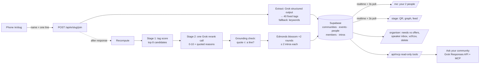

# Convene

**The 30-second member intake for live community events.** Open source (MIT), self-hosted, built for London community leads who run on Luma + WhatsApp.

Live demo: https://convene-zeta.vercel.app · Stage: https://convene-zeta.vercel.app/e/demo/stage

The organiser puts a QR code on the projector. People scan it and type their name and one line ("building X, need Y"). Within seconds their phone shows up to two people in the room to meet, each with two reasons that **quote what the two people actually wrote**. The stage screen shows a live graph of introductions. Afterwards the organiser gets a speaker inbox, a needs-vs-offers chart, a `contacts.vcf` for the WhatsApp group, and a member directory that remembers people across events — which any agent can query over MCP.

## The problem (evidence)

Gathered from public posts by London organisers (full notes in [`data/research.md`](data/research.md)):

- **Knowing your members is manual.** Unicorn Mafia's lead still adds new people to WhatsApp contacts by hand: "Adding new people to WhatsApp contacts. Is this a pain point for others also?" ([post](https://x.com/CharlieCheesma1/status/2110628241182507295), [reply](https://x.com/CharlieCheesma1/status/2110756784860180752)). "Why people join, why they stay..." is "a common topic across community leads" ([Francisco Terpolilli](https://x.com/frankterpo/status/2108541165830275243)).
- **Organisers chase speakers.** AIDLE / Not Another Pizza wanted speakers to apply "rather than having to constantly go out chasing them" ([Hugh Evans](https://hughevans.dev/not-another-pizza/)); finding new, diverse speakers is "a challenge that many organisers face" ([Emily Webber](https://emilywebber.co.uk/diversity-in-public-speaking-help-your-friends-find-their-voice/)).
- **No systematic follow-up.** "It's hard to get good data about your community without a lot of investment" and "we have no systematic way to follow up with them" ([Jonny Spicer, EA London Tech](https://jonnyspicer.com/blog/what-i-learned-in-my-first-year-of-community-building/)).
- **People don't meet the right people.** "Pub meetups where you talk to five people for four minutes each and remember none of them" ([Thinkers & Tinkerers](https://thinkersandtinkerers.com/)); communities exist to "create the conditions for exceptional people to find each other" ([Fergus McKenzie-Wilson](https://www.linkedin.com/posts/fergtech_some-of-the-best-founders-werent-even-founders-activity-7480270027754119168-k_3B)).

Today almost every London community runs on **Luma for events and WhatsApp for the community** (Unicorn Mafia, The Hack Collective, Corgi, Hackradar, AI Pilled, AI Agents Lab). Convene plugs into exactly that: it imports Luma guest CSVs and exports a vCard file you can add to WhatsApp in one tap.

## Compared to existing tools

| Tool | What it is | Price / limits | Open source | Live in the room |
|---|---|---|---|---|
| Brella | Conference matchmaking, contact sales | Est. $5k–$25k+ per event | No | Yes |
| Grip | Conference matchmaking, contact sales | Bundles from 1,000 participants | No | Yes |
| Swapcard | Event platform | From $610/yr, rises with attendees | No | Yes |
| 1Degree | Hosted, works on top of Luma, intros over WhatsApp | Free under 100 people | No | Yes |
| Socratica matchmaking | Python script over a Luma CSV | Interest matching only | Yes | No (batch) |
| aiDotEngineer/network | Event app with AI matching | Last updated 2023 | Yes | Unmaintained |

**1Degree is the closest tool** and is good: free for small events, Luma-native, WhatsApp intros. What Convene adds:

- **Open source and self-hosted.** The community owns its member data in its own Supabase. Another community can run it next week (5 minutes, below).
- **Grounded reasons.** Every reason quotes what the people wrote, and the quote is checked in code as an exact substring — no invented facts.
- **Optimal assignment.** Maximum-weight matching (Edmonds' blossom), run twice so everyone gets up to two intros, instead of first-come greedy.
- **Speaker inbox.** "Happy to speak on" turns attendees into a ranked speaker list, matched against what the room needs — speakers apply instead of being chased.
- **`contacts.vcf` for WhatsApp.** Only people who ticked consent; one tap imports them into your phone.
- **Community memory over MCP.** Members are remembered across events ("seen at 3 events") and the directory is queryable by any MCP client (Claude, Grok, Cursor) with read-only tools.

## Self-host in 5 minutes

1. **Fork / clone** this repo and `npm install`.
2. **Supabase:** create a project, then either `npx supabase link --project-ref <ref> && npx supabase db push`, or paste [`supabase/migrations/20261022190000_init.sql`](supabase/migrations/20261022190000_init.sql) into the SQL editor.
3. **Env:** `cp .env.example .env.local` and fill in the Supabase URL, anon key and service-role key. `XAI_API_KEY` is optional — without it Convene uses keyword extraction and tag-only matching.
4. **Try it locally:** `npm run seed` (loads 40 fictional sample members into event `demo`), `npm run dev`, open http://localhost:3000/e/demo/stage.
5. **Deploy:** `vercel` (or import the repo in Vercel), add the same env vars plus `NEXT_PUBLIC_BASE_URL=https://<your-app>.vercel.app`, `vercel --prod`.

Create an event from the home page; save the organiser link it shows (it contains the admin token).

## Architecture



## How matching works

1. **Extraction.** Each line is mapped by Grok (structured output, enum-constrained) to a fixed vocabulary of 40 tags — `offers`, `seeks`, `topics`, `speak_topics`. 15s timeout, one retry, then a keyword fallback so the app works with no API key.
2. **Stage 1 — candidates.** `score(i,j) = 2·|offers_i ∩ seeks_j| + 2·|offers_j ∩ seeks_i| + 0.5·|topics_i ∩ topics_j|`; top 8 candidates per member.
3. **Stage 2 — rerank.** One Grok call per new member scores each candidate 0–10 and gives two reasons, each with a `quote`.
4. **Grounding.** A reason is kept only if its quote is an exact substring of one of the two members' lines (checked in code, [`lib/ground.ts`](lib/ground.ts)). A pair with zero grounded reasons gets rerank 0. Pairs without grounded reasons get a template reason built from shared tags.
5. **Weight** = `0.4 · normalised tag score + 0.6 · rerank/10` (tag score only with no API key).
6. **Assignment.** Maximum-weight matching (Edmonds' blossom) among people with spare capacity; remove those pairs and run again, so each person gets up to two intros. Existing intros never change, so a phone never "loses" a match; recompute is idempotent. A greedy version is kept for comparison.

## Privacy

- Nothing is ever sent to anyone. Convene shows intros on screens; it never emails, messages or posts.
- Contact details are optional, only stored with an explicit consent tick, never exposed to the public API (column-level grants), and only exported in `contacts.vcf` to the organiser's token.
- Luma-imported emails are stored as non-consenting and are not exported.
- The organiser can delete all data for an event with one button. Data lives in the community's own Supabase.
- Lines are sent to xAI for extraction and reranking when `XAI_API_KEY` is set; leave it empty to keep everything in your own infrastructure.

## MCP

`/api/mcp` is a Streamable HTTP MCP server. Auth: `Authorization: Bearer <community or event admin token>`. Read-only tools: `search_members(query)`, `find_speakers(topic)`, `suggest_intros(member_id)`, `community_gaps()`. Contacts are never returned.

```json
{ "mcpServers": { "convene": { "url": "https://<your-app>/api/mcp", "headers": { "Authorization": "Bearer <token>" } } } }
```

The organiser page's **Ask your community** box calls the Grok Responses API with this server attached as an MCP tool.

## Evaluation

<!-- EVAL:START -->
| Assignment | Scoring | Precision@2 | Recall | should_not_meet produced | Intros | Grounded reasons |
|---|---|---|---|---|---|---|
| greedy | tags (keyword extraction, no API key) | 94% | 74% (17/23) | 1 | 35 | — |
| blossom | tags (keyword extraction, no API key) | 88% | 65% (15/23) | 2 | 37 | — |
| greedy | tags (Grok extraction) | 93% | 57% (13/23) | 1 | 38 | — |
| blossom | tags (Grok extraction) | 100% | 74% (17/23) | 0 | 38 | — |
| greedy | reranked (tags + Grok) | 82% | 61% (14/23) | 3 | 36 | 90% |
| blossom | reranked (tags + Grok) | 93% | 57% (13/23) | 1 | 38 | 88% |

- Data: 40 fictional sample members, 23 `should_meet` and 6 `should_not_meet` human-reviewed pairs. Each person gets at most 2 intros.
- Precision@2 = should_meet / (should_meet + should_not_meet) among produced intros that were labelled; recall = labelled should_meet pairs produced / all should_meet pairs.
- Extraction: 40/40 by Grok (p50 964 ms). Join-to-intro latency (extraction + one rerank call + assignment): p50 4171 ms, p95 4633 ms. Grounded reasons (blossom, reranked): 88% — the rest fall back to tag templates.
- Extraction model: grok-4.20-0309-non-reasoning; rerank model: grok-4.20-0309-non-reasoning. Run on 2026-10-22 19:39 UTC with `npm run eval`.
<!-- EVAL:END -->

Note: the keyword fallback was written while looking at this same sample data, so its scores are optimistic. Grok rows vary between runs.

## Known limits

- **Latency.** Join-to-intro is typically ~10 s on Vercel with Grok (extraction + one rerank call); it degrades to keyword extraction and tag-only matching when Grok is slow or absent. The eval's latency figures below were measured locally, so they include network round-trips to xAI from a laptop.
- **Blossom vs greedy.** Blossom maximises total match weight, which is not the same as matching the human labels: on the 40-person sample its recall is slightly below greedy's. We use it because it is the optimal assignment for the weights, and keep greedy for comparison.
- **Concurrency.** Two people joining at the same instant can, rarely, push someone to 3 intros (no row lock); duplicate pairs are prevented by a unique constraint.
- **Fixed vocabulary.** 40 tags cover the London tech-community lines we saw; niche needs fall back to Grok's reasons and the "topics" overlap.
- **Demo room.** Sample members are fictional (`is_sample`). Once real people join, intros between two sample members stop counting toward capacity, so live joiners can still be matched to the best sample people.
- **Auth.** Organiser access is a bearer token in the URL — fine for one-night events, not for long-lived sensitive communities. Rotate by editing `admin_token` in Supabase.
- Lines are free text and shown publicly on the stage screen; tell people that before they type.

## Tests

`npm test` runs Vitest over matching (0/1/odd rooms, capacity, determinism, blossom vs greedy, idempotent recompute), grounding, extraction fallback, Luma CSV import, vCard/CSV export, community memory keys and MCP helpers. `npm run eval` reproduces the table below.

## License

MIT. Sample data in `data/` is fictional.
