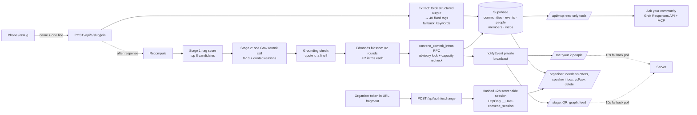

# Convene

**The 30-second member intake for live community events.** Open source (MIT), self-hosted, built for London community leads who run on Luma + WhatsApp.

Live demo: https://convene-zeta.vercel.app · Stage: https://convene-zeta.vercel.app/e/demo/stage

The organiser puts a QR code on the projector. People scan it and type their name and one line ("building X, need Y"). Within seconds their phone shows up to two people in the room to meet, each with two reasons that **quote what the two people actually wrote**. The stage screen shows a live graph of introductions. Afterwards the organiser gets a speaker inbox, a needs-vs-offers chart, a `contacts.vcf` for the WhatsApp group, and a member directory that remembers people across events — which any agent can query over MCP.

## The problem (evidence)

Gathered from public posts by London organisers (full notes in [`data/research.md`](data/research.md)):

- **Knowing your members is manual.** Unicorn Mafia's lead still adds new people to WhatsApp contacts by hand: "Adding new people to WhatsApp contacts. Is this a pain point for others also?" ([post](https://x.com/CharlieCheesma1/status/2110628241182507295), [reply](https://x.com/CharlieCheesma1/status/2110756784860180752)). "Why people join, why they stay..." is "a common topic across community leads" ([Francisco Terpolilli](https://x.com/frankterpo/status/2108541165830275243)).
- **Organisers chase speakers.** AIDLE / Not Another Pizza wanted speakers to apply "rather than having to constantly go out chasing them" ([Hugh Evans](https://hughevans.dev/not-another-pizza/)); finding new, diverse speakers is "a challenge that many organisers face" ([Emily Webber](https://emilywebber.co.uk/diversity-in-public-speaking-help-your-friends-find-their-voice/)).
- **No systematic follow-up.** "It's hard to get good data about your community without a lot of investment" and "we have no systematic way to follow up with them" ([Jonny Spicer, EA London Tech](https://jonnyspicer.com/blog/what-i-learned-in-my-first-year-of-community-building/)).
- **People don't meet the right people.** "Pub meetups where you talk to five people for four minutes each and remember none of them" ([Thinkers & Tinkerers](https://thinkersandtinkerers.com/)); communities exist to "create the conditions for exceptional people to find each other" ([Fergus McKenzie-Wilson](https://www.linkedin.com/posts/fergtech_some-of-the-best-founders-werent-even-founders-activity-7480270027754119168-k_3B)).

Today almost every London community runs on **Luma for events and WhatsApp for the community** (Unicorn Mafia, The Hack Collective, Corgi, Hackradar, AI Pilled, AI Agents Lab). Convene plugs into exactly that: it imports Luma guest CSVs and exports a vCard file you can add to WhatsApp in one tap.

## Compared to existing tools

| Tool | What it is | Price / limits | Open source | Live in the room |
|---|---|---|---|---|
| Brella | Conference matchmaking, contact sales | Est. $5k–$25k+ per event | No | Yes |
| Grip | Conference matchmaking, contact sales | Bundles from 1,000 participants | No | Yes |
| Swapcard | Event platform | From $610/yr, rises with attendees | No | Yes |
| 1Degree | Hosted, works on top of Luma, intros over WhatsApp | Free under 100 people | No | Yes |
| Socratica matchmaking | Python script over a Luma CSV | Interest matching only | Yes | No (batch) |
| aiDotEngineer/network | Event app with AI matching | Last updated 2023 | Yes | Unmaintained |

**1Degree is the closest tool** and is good: free for small events, Luma-native, WhatsApp intros. What Convene adds:

- **Open source and self-hosted.** The community owns its member data in its own Supabase. Another community can run it next week (5 minutes, below).
- **Grounded reasons.** Every reason quotes what the people wrote, and the quote is checked in code as an exact substring — no invented facts.
- **Optimal assignment.** Maximum-weight matching (Edmonds' blossom), run twice so everyone gets up to two intros, instead of first-come greedy.
- **Speaker inbox.** "Happy to speak on" turns attendees into a ranked speaker list, matched against what the room needs — speakers apply instead of being chased.
- **`contacts.vcf` for WhatsApp.** Only people who ticked consent; one tap imports them into your phone.
- **Community memory over MCP.** Members are remembered across events ("seen at 3 events") and the directory is queryable by any MCP client (Claude, Grok, Cursor) with read-only tools.

## Self-host in 5 minutes

1. **Fork / clone** this repo and `npm install`.
2. **Supabase:** create a project, link it with `npx supabase link --project-ref <ref>`, then apply every standard timestamped migration with `npx supabase db push`. For SQL-editor setup, apply all `*.sql` migrations in timestamp order; the initial migration alone is not a complete schema.
3. **Env:** `cp .env.example .env.local` and set the Supabase URL, anon key, service-role key, a stable, random `PERSON_KEY_PEPPER`, and a separate random `PUBLIC_ID_SECRET`. Before the first Vercel deploy, set `PERSON_KEY_PEPPER` for both Production and Preview; the app throws during build without it. Keep the pepper unchanged and backed up securely: losing it makes person keys unrecoverable. Keep `PUBLIC_ID_SECRET` stable so live graph IDs remain stable. `XAI_API_KEY` is optional — without it Convene uses keyword extraction and tag-only matching.
4. **Try it locally:** `npm run seed` (loads 40 fictional sample members into event `demo`), `npm run dev`, open http://localhost:3000/e/demo/stage.
5. **Deploy:** Before the first Vercel deploy, set `PERSON_KEY_PEPPER` and `PUBLIC_ID_SECRET` for both **Production** and **Preview** in Project Settings → Environment Variables. The production build throws if `PERSON_KEY_PEPPER` is missing, and `PUBLIC_ID_SECRET` is required in production to generate opaque live IDs. Back up `PERSON_KEY_PEPPER` securely; losing it makes existing person keys unrecoverable. Set `CRON_SECRET` and `RETENTION_DAYS` (365 by default) so the daily retention cron can run. Then run `vercel` (or import the repo in Vercel), add the other env vars plus `NEXT_PUBLIC_BASE_URL=https://<your-app>.vercel.app`, and deploy with `vercel --prod`.

Rate limiting trusts only the `x-vercel-forwarded-for` header. Behind any other proxy, all clients share one `unknown` bucket capped at 2 requests per window. Self-hosters must deploy on Vercel or adapt `trustedIp()` in [`lib/ratelimit.ts`](lib/ratelimit.ts) for their trusted proxy.

See the [deployment runbook](docs/DEPLOY-HARDENING.md) for secret setup and existing-install steps.

Create an event from the home page; save the organiser link it shows. The event token is carried in the URL fragment, exchanged for a 12-hour server-side session, and never sent in the page request. A community token is shown separately when a community is created.

## Architecture



## How matching works

1. **Extraction.** Each line is mapped by Grok (structured output, enum-constrained) to a fixed vocabulary of 40 tags — `offers`, `seeks`, `topics`, `speak_topics`. 15s timeout, one retry, then a keyword fallback so the app works with no API key.
2. **Stage 1 — candidates.** `score(i,j) = 2·|offers_i ∩ seeks_j| + 2·|offers_j ∩ seeks_i| + 0.5·|topics_i ∩ topics_j|`; top 8 candidates per member.
3. **Stage 2 — rerank.** One Grok call per new member scores each candidate 0–10 and gives two reasons, each with a `quote`.
4. **Grounding.** A reason is kept only if its quote is an exact substring of one of the two members' lines (checked in code, [`lib/ground.ts`](lib/ground.ts)). A pair with zero grounded reasons gets rerank 0. Pairs without grounded reasons get a template reason built from shared tags.
5. **Weight** = `0.4 · normalised tag score + 0.6 · rerank/10` (tag score only with no API key).
6. **Assignment and commit.** The pure planner computes a deterministic proposal for its input snapshot. `convene_commit_intros` then serializes concurrent plans with an advisory lock and rechecks duplicate-pair and two-intro capacity rules before committing. The integration suite exercises overlapping plans and sequential commits; recompute retries a dropped stale plan but never deletes or rewrites committed introductions. A greedy planner remains only for evaluation.

## Privacy

<!-- PRIVACY:START -->
- We collect your name, your one-line profile, optional X handle and speaker topic, and contact details only when you provide them.
- Your name and your line appear to people you are matched with. The room screen shows your first name and a quote from your line.
- Contact details are shared with the organiser only if you consent.
- The public directory shows your profile only if you opt in.
- The organiser can delete event data at any time.
- Each event controls external AI with `ai_enabled`; when it is off, external AI is not called and matching uses keyword extraction and tags.
- When `ai_enabled` is on, attendees can set `ai_opt_out`. Names, lines, X handles, and speaker topics from people who have not opted out may be processed by xAI for matching and Ask; opted-out people are excluded from AI prompts and receive basic matching only.
- Event data is retained for 365 days, then deleted automatically.
<!-- PRIVACY:END -->

The full data inventory is in [`docs/DATA.md`](docs/DATA.md). The [/privacy](/privacy) page shows the event-specific AI-enabled and AI-disabled notices.

## MCP

`/api/mcp` is a Streamable HTTP MCP server. Auth: `Authorization: Bearer <community or event admin token>`. An event token sees that event only; a community token sees all events in that community. The organiser dashboard uses an HttpOnly 12-hour session cookie. The Ask box gives xAI a short-lived, read-only, scope-bound MCP token instead of the organiser token. Read-only tools: `search_members(query)`, `find_speakers(topic)`, `suggest_intros(member_id)`, `community_gaps()`. Contacts are never returned.

Directory, search, speaker, gap, and suggestion reads use bounded service-role SQL functions. The public directory filters `directory_consent` in SQL and pages 50 people at a time with a stable keyset cursor; MCP and Ask keep their event and AI-opt-out scope in the database query.

```json
{ "mcpServers": { "convene": { "url": "https://<your-app>/api/mcp", "headers": { "Authorization": "Bearer <token>" } } } }
```

The organiser page's **Ask your community** box calls the Grok Responses API with this server attached as an MCP tool.

### Upgrading an existing installation

Before deploying this version, configure the same persistent `PERSON_KEY_PEPPER` for the maintenance command and every app instance, and configure `PUBLIC_ID_SECRET` for Production and Preview. The production build throws when `PERSON_KEY_PEPPER` is missing. Back up the pepper securely: losing it makes existing person keys unrecoverable. Apply the expand migrations with `npx supabase db push`. Then pause joins and imports and wait for all old app instances to drain; keep writes paused through the rehash and deployment so no old instance can create another raw person key. Run `npm run rehash:people:dry-run`, review its counts, then run `npm run rehash:people`. After deploying the hash-based app with that same pepper, verify legacy organiser links through the exchange flow and confirm returning-member identity before resuming writes. Only then apply `supabase/migrations/20261102120000_token_sessions_contract.sql.manual` to remove the legacy plaintext token columns. Do not apply the manual contract before the hash-based app is deployed and verified.

## Evaluation

<!-- EVAL:START -->
| Assignment | Scoring | Precision@2 | Recall | should_not_meet produced | Intros | Grounded reasons |
|---|---|---|---|---|---|---|
| greedy | tags (keyword extraction, no API key) | 94% | 74% (17/23) | 1 | 35 | — |
| blossom | tags (keyword extraction, no API key) | 88% | 65% (15/23) | 2 | 37 | — |
| greedy | tags (Grok extraction) | 93% | 57% (13/23) | 1 | 38 | — |
| blossom | tags (Grok extraction) | 100% | 74% (17/23) | 0 | 38 | — |
| greedy | reranked (tags + Grok) | 82% | 61% (14/23) | 3 | 36 | 90% |
| blossom | reranked (tags + Grok) | 93% | 57% (13/23) | 1 | 38 | 88% |

- Data: 40 fictional sample members, 23 `should_meet` and 6 `should_not_meet` human-reviewed pairs. Each person gets at most 2 intros.
- Precision@2 = should_meet / (should_meet + should_not_meet) among produced intros that were labelled; recall = labelled should_meet pairs produced / all should_meet pairs.
- Extraction: 40/40 by Grok (p50 964 ms). Join-to-intro latency (extraction + one rerank call + assignment): p50 4171 ms, p95 4633 ms. Grounded reasons (blossom, reranked): 88% — the rest fall back to tag templates.
- Extraction model: grok-4.20-0309-non-reasoning; rerank model: grok-4.20-0309-non-reasoning. Run on 2026-10-22 19:39 UTC with `npm run eval`.
<!-- EVAL:END -->

Note: the keyword fallback was written while looking at this same sample data, so its scores are optimistic. Grok rows vary between runs.

## Limits

- **Designed room and matching constraints.** The default room cap is 200 members (`MAX_MEMBERS_PER_EVENT`), and the commit RPC permits at most two committed introductions per real member.
- **Measured planner cost.** `npm run bench` on 2026-11-06 (Windows 10.0.26200, x64, Intel Core i7-12700H) measured the median of nine warmed pure-planning passes. Database commit time is intentionally `CI-only`: this benchmark does not connect to Postgres.

  | Members | Plan median (ms) | Pair evaluations | Database commit |
  |---:|---:|---:|---|
  | 50 | 0.85 | 144 | CI-only |
  | 100 | 1.81 | 558 | CI-only |
  | 200 | 5.17 | 2,200 | CI-only |
  | 500 | 23.36 | 13,958 | CI-only |

- **Default request and AI budgets.** 8 joins per 10 minutes per IP; 400 joins per hour per event; 5 event creations per hour per IP and 200 per day globally; 6 imports per hour per event; 5 Ask/MCP calls per minute and 20 per hour per scope; and 10 token exchanges per 10 minutes per IP. Missing client IPs use a two-request bucket. xAI calls are limited to 3,000 per UTC day globally and 400 per event per UTC day. The values are environment-tunable; their defaults are listed in `.env.example`.

## Development and CI

Production builds are verified only in Linux CI because that matches our deployment environment. The build must check prerendering with runtime-dependent routes: the root layout calls Next.js `connection()` for the request-time CSP nonce. Windows builds are outside the verified environment.

## Tests

`npm test` runs Vitest over matching (0/1/odd rooms, capacity, deterministic pure planning, blossom vs greedy, and commit-retry behaviour), grounding, extraction fallback, Luma CSV import, vCard/CSV export, community memory keys, routes, components, and MCP helpers. The Supabase integration suite separately checks the commit RPC under overlapping and sequential plans. `npm run eval` reproduces the table below.

## License

MIT. Sample data in `data/` is fictional.
